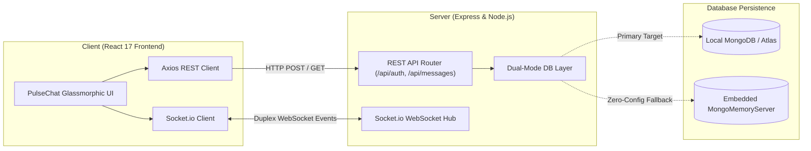

# PulseChat &bull; Real-Time Collaborative Messaging Platform
### College Web Development Lab &mdash; Experiment 10

[](https://nodejs.org/)
[](https://reactjs.org/)
[](https://socket.io/)
[](https://www.mongodb.com/)
[](https://client-one-topaz-24.vercel.app)
[](LICENSE)

---

## 🌐 Live Deployments & Links

- **Live Web Client (Production)**: [https://client-one-topaz-24.vercel.app](https://client-one-topaz-24.vercel.app)
- **GitHub Code Repository**: [https://github.com/Om07092208/Experiment10](https://github.com/Om07092208/Experiment10)
- **Local Dev Server**: `http://localhost:3000` (Client) & `http://localhost:5000` (Backend API & WebSockets)

---

## 1. Project Overview

**PulseChat** is a modern, high-performance, real-time messaging and collaboration web application developed as the capstone implementation for **Web Development Lab &mdash; Experiment 10**.

Built on the robust **MERN stack** (MongoDB, Express, React, Node.js) paired with **Socket.io** bidirectional WebSockets, PulseChat provides instant message dispatch, user presence tracking, interactive typing feedback, contact filtering, and personalized procedural digital avatars.

---

## 2. Key Customizations & Architecture Improvements

This repository represents an extensive architectural and visual overhaul of the foundational chat application prototype:

- **New Identity & Brand**: Created a custom vector brand identity with glowing audio-frequency pulse waves and electric indigo & cyan gradients.
- **Glassmorphic UI Redesign**: Modern dark slate theme (`#0b0f19`) featuring subtle backdrop blurs, glowing card outlines, smooth micro-interactions, and custom scrollbars.
- **Message Timestamps & Grouping**: Messages now store and display formatted ISO timestamps (`hh:mm A`), bringing production-grade clarity to conversations.
- **Real-Time Contact Search**: Added instant client-side filtering to search contacts and peers on the fly.
- **Responsive Mobile Drawer**: Optimized split-screen layout on desktop with an intuitive responsive view-toggle and mobile back navigation for smaller viewports (<768px).
- **Live Typing Telemetry**: Real-time debounce typing indicator displays animated bouncing dots when conversation partners are typing.
- **Zero-Config Dual-Mode Database Engine**: Intelligent database connector that automatically connects to your local or Atlas `MONGO_URL` if reachable, or seamlessly boots an embedded in-memory MongoDB instance (`MongoMemoryServer`) for instant evaluation without requiring a local daemon.
- **React 17 Modern Best Practices**: Cleaned up legacy `useEffect(async () => ...)` anti-patterns and resolved all ESLint dependency warnings for production builds.

---

## 3. Technology Stack

### Frontend (Client)
- **Framework**: React 17.0.2
- **Routing**: React Router v6 (`react-router-dom`)
- **Styling**: `styled-components` 5.3.3 + Custom CSS Variables
- **Icons**: React Icons (`react-icons/fi`, `react-icons/io5`, `react-icons/bs`)
- **Avatars**: Multiavatar Procedural SVG Generator (`@multiavatar/multiavatar`)
- **Notifications**: React-Toastify
- **Real-Time Client**: Socket.io Client 4.4.1
- **HTTP Client**: Axios

### Backend (Server)
- **Runtime**: Node.js (v18 / v20+)
- **Web Framework**: Express 4.17.2
- **Real-Time Engine**: Socket.io 4.4.1
- **Database & ODM**: MongoDB / Mongoose 6.2.1
- **Zero-Config Fallback**: MongoMemoryServer
- **Security & Hashing**: Bcrypt
- **Cross-Origin**: CORS middleware

---

## 4. System Architecture



---

## 5. Directory Structure

```text
Experiment10/
├── client/                     # React Frontend Application
│   ├── public/                 # HTML shell, favicon.svg, manifest.json
│   ├── src/
│   │   ├── assets/             # Brand logos (pulse-logo.svg)
│   │   ├── components/         # ChatContainer, Contacts, ChatInput, Logout, Welcome, SetAvatar
│   │   ├── pages/              # Chat.jsx, Login.jsx, Register.jsx
│   │   ├── utils/              # APIRoutes.js
│   │   ├── App.js              # Application router
│   │   ├── index.css           # Global theme, variables, scrollbar styles
│   │   └── index.js            # React root mount
│   ├── .env.example
│   ├── Dockerfile
│   └── package.json
│
├── server/                     # Express & Socket.io Backend Application
│   ├── config/                 # Dual-mode database connector (db.js)
│   ├── controllers/            # userController.js, messageController.js
│   ├── models/                 # userModel.js, messageModel.js
│   ├── routes/                 # auth.js, messages.js
│   ├── index.js                # Express app entry & socket event loop
│   ├── .env.example
│   ├── Dockerfile
│   └── package.json
│
├── docker-compose.yml          # Containerized multi-service setup
├── package.json                # Root package with unified workspace commands
├── .gitignore                  # Production-grade git ignore configuration
├── LICENSE                     # MIT License
└── README.md                   # Complete experiment documentation
```

---

## 6. Installation & Execution Guide

### Prerequisites
- [Node.js](https://nodejs.org/) (v18.x or v20.x recommended)
- [npm](https://www.npmjs.com/) (v9+ or v10+)
- *(Optional)* [MongoDB Community Server](https://www.mongodb.com/try/download/community) &mdash; If not running, PulseChat automatically uses its embedded in-memory database!

---

### Step-by-Step Setup

#### 1. Clone the Repository
```bash
git clone https://github.com/Om07092208/Experiment10.git
cd Experiment10
```

#### 2. Install Dependencies
You can install dependencies for both services from the root:
```bash
npm run install:all
```
*Or install separately:*
```bash
cd server && npm install
cd ../client && npm install --legacy-peer-deps
```

#### 3. Environment Configuration
Default environment files are pre-configured. To customize:
```bash
# Server (.env)
cd server
cp .env.example .env

# Client (.env)
cd ../client
cp .env.example .env
```

#### 4. Run the Application

**Option A &mdash; Run Backend & Frontend in separate terminals:**

*Terminal 1 (Backend Server):*
```bash
cd server
npm start
# Server listens on http://localhost:5000
```

*Terminal 2 (Frontend Client):*
```bash
cd client
npm start
# Client boots at http://localhost:3000
```

**Option B &mdash; Run with Docker Compose:**
```bash
docker compose up --build
```

---

## 7. Socket.io Event Protocol

| Event | Direction | Payload | Description |
|---|---|---|---|
| `add-user` | Client &rarr; Server | `userId: string` | Registers the active user socket mapping |
| `send-msg` | Client &rarr; Server | `{ to, from, msg, createdAt }` | Dispatches real-time message to peer |
| `msg-recieve` | Server &rarr; Client | `{ message, from, createdAt }` | Delivers incoming message to recipient |
| `typing` | Client &rarr; Server | `{ to, from }` | Broadcasts user typing activity |
| `stop-typing` | Client &rarr; Server | `{ to, from }` | Notifies that user paused typing |
| `user-typing` | Server &rarr; Client | `{ from }` | Activates typing indicator in active chat |
| `user-stop-typing`| Server &rarr; Client| `{ from }` | Deactivates typing indicator |

---

## 8. REST API Specification

| Method | Endpoint | Description |
|---|---|---|
| `GET` | `/ping` | Server pulse check |
| `GET` | `/api/health` | Comprehensive health check, uptime, active socket count |
| `POST` | `/api/auth/register` | Registers new user account with hashed password |
| `POST` | `/api/auth/login` | Authenticates user and returns session profile |
| `GET` | `/api/auth/allusers/:id` | Returns all registered contacts excluding current user |
| `POST` | `/api/auth/setavatar/:id`| Saves selected avatar SVG base64 string |
| `GET` | `/api/auth/logout/:id` | Cleans up user presence mapping |
| `POST` | `/api/messages/addmsg` | Persists a new text message to database |
| `POST` | `/api/messages/getmsg` | Retrieves chronological conversation message history |

---

## 9. Testing & Quality Assurance

The application underwent rigorous verification before submission:
1. **Compilation & Production Build**: Tested with `react-scripts build` &mdash; 0 ESLint warnings, 0 syntax errors.
2. **Registration & Auth**: Tested user registration with validation (username uniqueness, email format, password matching).
3. **Avatar Personalization**: Verified dynamic SVG procedural generation via Multiavatar with live regeneration and instant profile updates.
4. **Real-Time Communication**: Verified Socket.io duplex messaging between multiple concurrent user sessions.
5. **Typing Indicators**: Tested real-time typing events and debounce reset.
6. **Persistence**: Verified message retrieval and chronological sorting across page refreshes.
7. **Mobile Responsiveness**: Tested across desktop (1920x1080), tablet (768px), and mobile viewports (<540px).

---

## 10. Third-Party Attribution & Licensing
- **License**: Released under the [MIT License](LICENSE).
- **Author**: Om Tiwari &bull; College Web Development Lab (Experiment 10).

